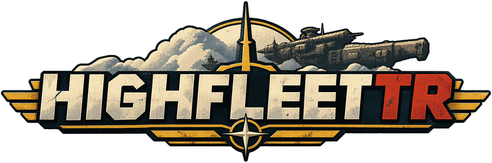

  

# HighFleet Türkçe Yama

[HighFleet](https://store.steampowered.com/app/1434950/HighFleet/) için hayran yapımı Türkçe çeviri.
Oyunun bütün diyalogları, görevleri, arayüz yazıları, eşya ve gemi açıklamaları — 3376 metin parçası,
yaklaşık 28 bin kelime — ve ana menü dahil 45 görsel.

**Hedef sürüm:** HighFleet 1.16 (Deus In Nobis)

## İndir

**[HighFleet-Turkce-Yama.zip](https://github.com/ugurdeser/highfleet-tr/releases/latest/download/HighFleet-Turkce-Yama.zip)** — son sürüm

Önceki sürümler ve değişiklik notları: [Releases](https://github.com/ugurdeser/highfleet-tr/releases)

## Kurulum

Oyun **kapalı** olmalı. Zip'i bir klasöre çıkar, sonra:

1. `kur.bat` — metin yamasını kurar. Hiçbir şey gerektirmez.
2. `gorsel_kur.bat` — görsel yamasını kurar (ana menü, posterler, paneller). [Python](https://www.python.org/downloads/) gerektirir; kurarken **Add Python to PATH** kutusunu işaretle.

İkisi de oyunu kendisi bulur; bulamazsa klasör yolunu sorar (Steam'de HighFleet'e sağ tık → Yönet → Yerel dosyalara göz at). Kurulumdan önce her dosyanın yedeği alınır.

Görsel yaması isteğe bağlı: metin yaması tek başına da çalışır, yalnızca ana menü ve posterler İngilizce kalır.

## Kaldırma

- **Görseller:** `gorsel_geri_al.bat`
- **Metin:** oyun klasöründe `Data\Dialogs\english.seria_enc.orig` dosyasını `english.seria_enc` olarak yeniden adlandır.
- **İkisi birden:** Steam → HighFleet → Yönet → Oyun dosyalarının bütünlüğünü doğrula.

## Bilinen sınırlar

- **Metinlerde Türkçe karakter yok.** Oyunun bitmap fontunda 0x80–0xFF aralığı Kiril alfabesine ayrılmış, Türkçe harflere yer kalmıyor. Metinler bu yüzden ASCII'ye indirildi (GECIS IZNI, CIKIS…). Görsellerde böyle bir kısıt yok.
- **Görseller yeniden çizildi.** Sprite'lar bir görüntü modeliyle üretildi; boyut, konum ve saydamlık korunuyor ama yazı tipi ve doku orijinaliyle birebir aynı olmayabilir.
- **Çevrilmeyenler:** haritadaki şehir isimleri (harita dokusuna gömülü), madalyalar ve bazı küçük sprite'lar. Rusça yazılı görseller kasten olduğu gibi bırakıldı.

Ayrıntılar: [OKUBENI.txt](OKUBENI.txt). Çeviriyi yeniden üretmek ya da geliştirmek için: [kaynak/README.md](kaynak/README.md).

## Lisans

- Kaynak kodu (`*.py`, `*.bat`): MIT
- Çeviri metni ve görseller: [CC BY-NC-SA 4.0](https://creativecommons.org/licenses/by-nc-sa/4.0/)

`seria_enc` şifrelemesinin çözümü [stopnoanime/highfleet-dialog](https://github.com/stopnoanime/highfleet-dialog) projesine aittir.

HighFleet'in bütün hakları Konstantin Koshutin ve MicroProse'a aittir. Bu ücretsiz bir hayran çalışmasıdır, satılamaz.
